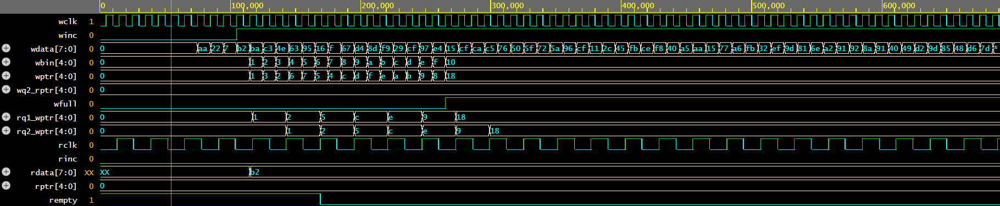
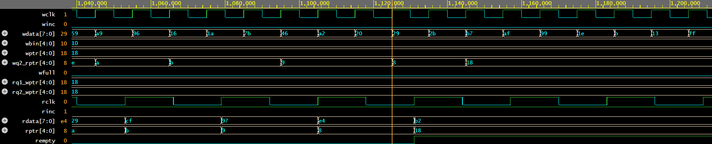

# Asynchronous FIFO

A dual-clock FIFO for passing data safely between two unrelated clock domains, written in Verilog and verified with a self-checking testbench.

## Features

- Separate write clock (`wclk`) and read clock (`rclk`) with independent active-low resets
- Parameterised data width (`DSIZE`, default 8) and depth (`2^ASIZE`, default 16)
- Read and write pointers converted to Gray code before crossing clock domains, so only one bit changes per step
- Two flip-flop synchronizers for each pointer crossing
- `ASIZE+1`-bit pointers, with the extra bit used to tell full from empty
- Registered `wfull` and `rempty` flags
- First-word fall-through: `rdata` shows the oldest word before `rinc` is asserted

## Files

| File | Description |
|------|-------------|
| `design.sv` | Asynchronous FIFO |
| `testbench.sv` | Self-checking testbench |

## Verification

The testbench keeps a reference queue of every accepted write and checks each read against it. It also checks that the Gray pointers never change by more than one bit per clock and that the occupancy never goes below 0 or above the depth.

1. Overfill: 20 write attempts into a 16-entry FIFO, only 16 must be accepted and `wfull` must be set
2. Overdrain: 20 read attempts, only 16 must be returned and `rempty` must be set
3. 3000 random words with a fast writer (100 MHz) and slow reader (38.5 MHz)
4. 3000 random words with the clocks swapped (38.5 MHz writer, 100 MHz reader)

6016 words written, 6016 words read, all in order and matching.

Simulated with Icarus Verilog on EDA Playground.

## Results

### Simulation result

### Overfill and pointer synchronization

`winc` stays high, but writes stop after 16 words and `wfull` goes high. The Gray-coded `wptr` changes one bit per write and passes through `rq1_wptr` and `rq2_wptr` into the read domain, after which `rempty` goes low.

### Overdrain

The last reads of the drain. When `rptr` reaches `wptr` (`18`), `rempty` goes high and the remaining read requests are ignored.

